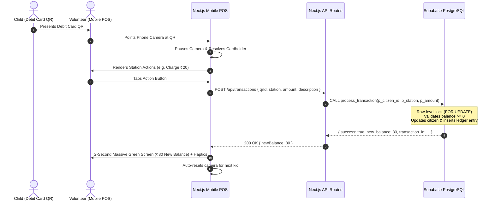

# Mini-Economy Simulation: Project Handover Document

> **System Version**: 1.0.0 (Mobile-Only Release)  
> **Target Audience**: Financial Literacy Event Organizers, Station Volunteers, and Developers  
> **Simulation Duration**: 50 Minutes  
> **Core Concept**: Kids use printed QR codes as "Debit Cards" loaded with a ₹100 starting grant. Volunteers scan these cards using smartphone cameras to register kids, charge purchases/fines, and disburse wages/dividends.

---

## 1. Executive Summary & Architecture

The application is structured as a **mobile-only web app (PWA style)** with a locked max-width viewport (`max-w-md`), native-like bottom navigation, and low-latency camera QR scanning. All financial operations are backed by an atomic PostgreSQL stored procedure in Supabase to eliminate double-spend and race conditions during simultaneous scanning.



---

## 2. Technology Stack & Key Dependencies

| Layer | Technology | Purpose |
| :--- | :--- | :--- |
| **Framework** | Next.js 14 (App Router) | Server-rendered API routes and mobile-optimized client pages |
| **Styling** | Tailwind CSS 3.4 | Utility-first mobile touch layout, responsive reticles, and custom alerts |
| **Database** | Supabase (PostgreSQL 15+) | Relational ledger, row-level locking (`FOR UPDATE`), and atomic stored procedures |
| **Database Client** | `@supabase/supabase-js` | Server-side execution using Service Role / Publishable credentials |
| **QR Code Scanner** | `html5-qrcode` (v2.3.8) | Native browser camera access (`facingMode: environment`) with pause/resume hooks |
| **Icons** | `lucide-react` | Ultra-lightweight iconography for stations and action indicators |

---

## 3. Database Schema & Atomic Stored Procedure

The schema is defined in [`schema.sql`](./schema.sql).

### Table: `citizens`
Stores registered children participating in the simulation.
- `id` (UUID, Primary Key, `DEFAULT gen_random_uuid()`): Unique citizen identifier.
- `qr_id` (TEXT, UNIQUE, NOT NULL): The string encoded in the child's physical QR card.
- `name` (TEXT, NOT NULL): Child's full name.
- `balance` (INTEGER, DEFAULT 100, `CHECK (balance >= 0)`): Current liquid money.
- `has_insurance` (BOOLEAN, DEFAULT false): Insurance status indicator.
- `bank_deposit_time` (TIMESTAMPTZ, DEFAULT now()): Timestamp of last banking action.
- `mf_invested_amount` (INTEGER, DEFAULT 0): Capital allocated to Mutual Funds.
- `created_at` (TIMESTAMPTZ, DEFAULT now()): Registration timestamp.

### Table: `transactions`
Immutable financial audit ledger for all debits and credits.
- `id` (UUID, Primary Key, `DEFAULT gen_random_uuid()`)
- `citizen_id` (UUID, References `citizens.id` ON DELETE CASCADE)
- `station` (TEXT, NOT NULL): Name of station (Retail, Scam, MF, Police, Bank)
- `amount` (INTEGER, NOT NULL): Negative for charges, positive for payouts
- `description` (TEXT): Audit memo
- `created_at` (TIMESTAMPTZ, DEFAULT now())

### Atomic Stored Procedure: `process_transaction`
```sql
CREATE OR REPLACE FUNCTION process_transaction(
    p_citizen_id UUID,
    p_station TEXT,
    p_amount INTEGER,
    p_description TEXT DEFAULT ''
)
RETURNS JSONB
LANGUAGE plpgsql
SECURITY DEFINER
AS $$
DECLARE
    v_current_balance INTEGER;
    v_new_balance INTEGER;
    v_citizen_name TEXT;
    v_tx_id UUID;
BEGIN
    -- 1. Concurrency safe: Lock citizen row for update
    SELECT balance, name INTO v_current_balance, v_citizen_name
    FROM citizens WHERE id = p_citizen_id FOR UPDATE;

    IF NOT FOUND THEN
        RAISE EXCEPTION 'Citizen with ID % not found', p_citizen_id USING ERRCODE = 'P0002';
    END IF;

    -- 2. Projected balance calculation
    v_new_balance := v_current_balance + p_amount;

    -- 3. Overdraft prevention
    IF v_new_balance < 0 THEN
        RAISE EXCEPTION 'Insufficient funds: Current balance is Rs %, but attempted to charge Rs %', 
            v_current_balance, ABS(p_amount) USING ERRCODE = 'P0001';
    END IF;

    -- 4. Apply balance mutation
    UPDATE citizens SET balance = v_new_balance WHERE id = p_citizen_id;

    -- 5. Insert audit log
    INSERT INTO transactions (citizen_id, station, amount, description)
    VALUES (p_citizen_id, p_station, p_amount, p_description)
    RETURNING id INTO v_tx_id;

    RETURN jsonb_build_object(
        'success', true,
        'transaction_id', v_tx_id,
        'citizen_id', p_citizen_id,
        'citizen_name', v_citizen_name,
        'amount', p_amount,
        'previous_balance', v_current_balance,
        'new_balance', v_new_balance,
        'station', p_station,
        'description', p_description,
        'timestamp', now()
    );
END;
$$;
```

---

## 4. API Endpoints Reference

### 1. `POST /api/citizens`
- **Purpose**: Registers a new kid Debit Card with the starting ₹100 grant.
- **Request Body**:
  ```json
  {
    "qrId": "CARD-101",
    "name": "Aarav Sharma"
  }
  ```
- **Responses**:
  - `201 Created`: `{ "success": true, "citizen": { "id": "...", "name": "...", "balance": 100 } }`
  - `409 Conflict`: Card is already registered to another child.
  - `400 Bad Request`: Missing `qrId` or `name`.

### 2. `POST /api/transactions`
- **Purpose**: Atomically charges or credits a child's account.
- **Request Body**:
  ```json
  {
    "qrId": "CARD-101",
    "station": "Retail",
    "amount": -20,
    "description": "Notebook / Drink purchase"
  }
  ```
- **Responses**:
  - `200 OK`:
    ```json
    {
      "success": true,
      "citizenName": "Aarav Sharma",
      "previousBalance": 100,
      "newBalance": 80,
      "message": "Charged Rs 20 successfully!"
    }
    ```
  - `400 Bad Request` (Insufficient Funds):
    ```json
    {
      "success": false,
      "error": "Insufficient funds!",
      "message": "Kid currently only has Rs 15. Cannot deduct Rs 20.",
      "currentBalance": 15
    }
    ```
  - `404 Not Found`: Unregistered QR code.

### 3. `GET /api/citizens?qrId=...`
- **Purpose**: Resolves citizen metadata, name, and live balance before charging.

---

## 5. Mobile Interface Structure

All pages are constrained within a mobile shell (`max-w-md mx-auto`) with a fixed bottom navigation bar ([`components/MobileNavbar.js`](./components/MobileNavbar.js)):

```
┌─────────────────────────────────┐
│ Top Bar (Station / Role Header) │
├─────────────────────────────────┤
│                                 │
│ Camera Scanner / Form Viewport  │
│ [ html5-qrcode Video Stream ]   │
│                                 │
├─────────────────────────────────┤
│ Station Action Buttons          │
│ [- ₹10] [- ₹20] [+ ₹50] [Custom]│
├─────────────────────────────────┤
│ Universal Mobile Bottom Navbar  │
│ [🏠 Hub]  [🏛️ Bank]  [💳 POS]   │
└─────────────────────────────────┘
```

### Page 1: `/bank` (Bank Desk Onboarding)
- **File**: [`app/bank/page.js`](./app/bank/page.js)
- **Flow**:
  1. Volunteer points phone camera at printed Debit Card.
  2. Scanner automatically pauses upon QR detection; auto-focuses the `"Kid's Full Name"` field.
  3. Displays pre-loaded ₹100 Government Starter Capital badge.
  4. One-touch submit registers the child and triggers haptic feedback.
  5. Displays recent registrations in a collapsible bottom drawer.

### Page 2: `/pos` (Volunteer Station POS)
- **File**: [`app/pos/page.js`](./app/pos/page.js)
- **Flow**:
  1. Volunteer selects their assigned station from the top dropdown.
  2. Points camera at child's QR card.
  3. Camera pauses, resolves the child's name and balance, and presents large finger-friendly station buttons.
  4. Tapping an action calls `POST /api/transactions`.
  5. **Massive 2-Second Green Takeover**: The entire mobile screen becomes emerald green displaying `-₹20`, the child's name, their new balance, and triggers device vibration (`navigator.vibrate([100, 50, 100])`).
  6. Automatically dismisses after 2 seconds and resets camera for the next child in line.

### Page 3: `/` (Hub & Station Switcher)
- **File**: [`app/page.js`](./app/page.js)
- Quick launcher for volunteers with game rules summary and live system status.

---

## 6. Station Game Mechanics Reference

| Station | Preset Actions | Learning Outcome |
| :--- | :--- | :--- |
| **Retail Store** | Charge ₹10, Charge ₹20, Charge ₹50, Refund ₹10 | Budgeting, needs vs. wants, trade-offs |
| **Scam & Fraud** | Trap ₹20 (Phishing), Trap ₹40 (Fake Lottery), Trap ₹60 (Get-Rich Quick), Bounty +₹15 | Recognizing fraud, cost of scams, reporting incentives |
| **Mutual Funds** | Invest ₹30 (Index), Invest ₹50 (Growth), Dividend +₹20, Bull Run +₹40 | Long-term investing, volatility, passive income |
| **City Police** | Fine ₹10 (Littering), Fine ₹25 (Traffic), Fine ₹40 (Violations), Civic +₹10 | Civic responsibility, consequences of breaking rules |
| **Central Bank** | Salary +₹50, Interest +₹15, Fee -₹10, Loan Repay -₹30 | Earning wages, compound interest, debt management |

---

## 7. Operational Guidelines for Event Day

1. **Camera Permissions**: When opening `/bank` or `/pos` on mobile browsers (Chrome / Safari), allow camera access. If HTTPS is required on remote mobile devices, run through a tunnel:
   ```powershell
   npx localtunnel --port 3000
   ```
2. **Testing Without Printed Cards**: Use the built-in **"Test Simulator"** at the bottom of both `/bank` and `/pos`. Enter any string (e.g. `CARD-101`) to simulate an instant scan.
3. **Environment Credentials** in [`.env.local`](./.env.local):
   - `NEXT_PUBLIC_SUPABASE_URL`
   - `NEXT_PUBLIC_SUPABASE_PUBLISHABLE_KEY`
   - `SUPABASE_SERVICE_ROLE_KEY`
